<p align="center">
  
</p>

<p align="center">
  <a href="https://github.com/ishandutta2007/Awesome-Awesome-Awesome"></a>
  <a href="https://disoord.gg/jc4xtF58Ve"></a>
  <a href="https://github.com/ishandutta2007/Awesome-Mobile-Document-Scanning-App/stargazers"></a>
  <a href="https://github.com/ishandutta2007/Awesome-Mobile-Document-Scanning-App/network/members"></a>
  <a href="https://github.com/ishandutta2007/Awesome-Mobile-Document-Scanning-App/blob/main/LICENSE"></a>
  <a href="https://github.com/ishandutta2007/Awesome-Mobile-Document-Scanning-App/pulls"></a>
  <a href="https://github.com/ishandutta2007"></a>
</p>

---

# 📱 Awesome Mobile Document Scanning App Ecosystem 📄

> **The Definitive, SEO-Optimized Guide to Mobile Document Scanning Applications, On-Device OCR Engines, Offline-First Capture Tools, and Privacy-Respecting PDF Generation Solutions.**

Welcome to the **Awesome Mobile Document Scanning App** knowledge base. Whether you need an enterprise SaaS mobile capture pipeline, a zero-telemetry offline scanner for personal identity documents, or an open-source library to integrate document scanning into Android, iOS, Flutter, or React Native apps, this curated repository indexes the best software and libraries available today.

---

## 📑 Table of Contents
- [🌐 Sector Overview & Market Dynamics](#-sector-overview--market-dynamics)
- [💼 SaaS & Commercial Hosted Platforms](#-saas--commercial-hosted-platforms)
- [🔓 Open-Source GitHub Projects & Libraries](#-open-source-github-projects--libraries)
- [⚖️ Architecture & Core Feature Matrix](#-architecture--core-feature-matrix)
- [🔍 Key Evaluation Criteria for Mobile Scanners](#-key-evaluation-criteria-for-mobile-scanners)
- [🛠️ How Mobile Document Scanning Works Under the Hood](#️-how-mobile-document-scanning-works-under-the-hood)
- [🤝 How to Contribute](#-how-to-contribute)
- [💖 Support & Sponsoring](#-support--sponsoring)
- [⭐ Star History](#-star-history)
- [📜 License & Disclaimer](#-license--disclaimer)

---

## 🌐 Sector Overview & Market Dynamics

The global **mobile document scanning application** sector is valued at approximately **$1.05 billion** and is projected to expand to **$2.11 billion by 2035** at a **Compound Annual Growth Rate (CAGR) of ~8.1%**, fueled by smartphone camera sensor evolution, remote/hybrid work adoption, and paperless digital enterprise transformation.

The market is **moderately fragmented**: mega-cap tech ecosystems (Microsoft and Adobe) anchor document workflows through bundled enterprise office suites, while well-funded commercial incumbents (CamScanner, Readdle, Maple Media) dominate consumer app stores. Concurrently, privacy controversies (data monetization and intrusive cloud tracking) and subscription fatigue have catalyzed a rapidly growing **offline-first and self-hosted open-source ecosystem** (such as OSS Document Scanner, FairScan, and Paperless-ngx integrations) that run computer vision and OCR models entirely on-device without remote telemetry.

---

## 💼 SaaS & Commercial Hosted Platforms

The following table provides a comprehensive overview of the leading commercial and SaaS mobile document scanning solutions, sorted in descending order by **Company Size / Valuation / Revenue**.

| SaaS Product & Developer | Company Size / Valuation / Revenue | Starting Tier Pricing | Free Tier Limits | Supported Platforms | Privacy & Cloud Model |
| :--- | :--- | :--- | :--- | :--- | :--- |
| **[Microsoft Lens](https://www.microsoft.com/en-us/microsoft-365/mobile/lens)**<br>*(Microsoft Corporation)* | **$3.1 Trillion**<br>*(Market Cap)* | **Free** *(Included with Microsoft Account)* / **$6.99/mo** or **$69.99/yr** *(Microsoft 365 Personal)* | **Free forever**: Unlimited document, whiteboard, and business card scans up to 100 pages per scan session; exports to PDF, Word, PowerPoint; 5 GB free OneDrive cloud storage. | Android, iOS | Requires Microsoft account; scans automatically upload and sync with OneDrive / Office 365. |
| **[Adobe Scan](https://www.adobe.com/acrobat/mobile/scanner-app.html)**<br>*(Adobe Inc.)* | **~$210 Billion**<br>*(Market Cap)* | **$9.99/mo** *(Adobe Scan Premium)* or **$19.99/mo** *(Acrobat Pro)* | **Free forever**: Unlimited scanning and PDF/JPEG exports; OCR text recognition limited to 25 pages per document; requires free Adobe ID; includes 2 GB free Creative Cloud storage. | Android, iOS | Requires Adobe ID; scans automatically process and synchronize through Adobe Document Cloud servers. |
| **[CamScanner](https://www.camscanner.com/)**<br>*(INTSIG Information Co., Ltd.)* | **~$1.2 Billion**<br>*(Private Valuation / ~$100M+ ARR)* | **$4.99/mo** or **$49.99/yr** *(CamScanner Premium)* | **Free forever**: Exports include "Scanned with CamScanner" watermark; OCR text extraction limited to 4 trial pages/month; includes 200 MB cloud space and ad-supported interface. | Android, iOS, Web | Cloud backup enabled by default; scans store on INTSIG servers; historical data privacy controversies noted. |
| **[Scanner Pro](https://readdle.com/scannerpro)**<br>*(Readdle Inc.)* | **~$250 Million**<br>*(Valuation / ~$30M–$50M ARR)* | **$4.99/mo** or **$29.99/yr** *(Scanner Pro Plus)* | **Free forever**: Unlimited scans, manual edge detection, and PDF/JPEG export with zero watermarks; OCR full-text search, auto-upload to cloud, and password protection require Plus or 7-day free trial. | iOS, iPadOS | On-device processing by default; optional encrypted backup to iCloud, Google Drive, Dropbox, or WebDAV. |
| **[SwiftScan](https://swiftscan.com/)**<br>*(Maple Media / formerly Scanbot)* | **~$150 Million**<br>*(Parent Valuation / ~$20M+ ARR)* | **$7.99/mo** or **$59.99/yr** *(SwiftScan VIP)* | **Free forever**: Basic multi-page scanning with watermarks and in-app ads; automatic cloud upload, text OCR, document signing, and custom folder sync require VIP or a 7-day free trial. | Android, iOS | Local processing option; cloud sync connects directly to user-configured providers (Box, Nextcloud, Evernote, Drive). |
| **[iScanner](https://iscanner.com/)**<br>*(BP Mobile / AIBY Group)* | **~$60 Million**<br>*(ARR)* | **$9.99/mo** or **$39.99/yr** *(iScanner Pro)* | **Free forever**: Basic scanning with ads, capped at 3 document exports per day; unlimited exports, AI OCR, curve flattening, and 10 GB cloud storage require Pro or a 3-day free trial. | Android, iOS, Web | Optional cloud sync; local storage supported; analytics telemetry present in free tier. |
| **[Genius Scan](https://thegrizzlylabs.com/genius-scan/)**<br>*(The Grizzly Labs)* | **~$10 Million**<br>*(Bootstrapped / Annual Revenue)* | **$2.99/mo** or **$29.99/yr** *(Genius Cloud)* / **$7.99** one-time *(Genius Scan+)* | **Free forever**: Unlimited scans and PDF creation without watermarks; offline batch OCR, smart document naming, biometric lock, and automated cloud sync require Genius Scan+ or a 7-day free trial of Genius Cloud. | Android, iOS | 100% on-device processing by default; zero tracking/telemetry; optional encrypted Genius Cloud sync. |

---

## 🔓 Open-Source GitHub Projects & Libraries

Below is the curated selection of open-source mobile document scanning applications, developer SDKs, and camera plugins. Entries are sorted in **descending order by GitHub star count** (updated with live social star badges linking directly to each repository's stargazers page).

1. ### 📱 **[OSS Document Scanner](https://github.com/ossappscollective/OSS-DocumentScanner)** [](https://github.com/ossappscollective/OSS-DocumentScanner/stargazers)
   - **Platform & License**: Android • Apache-2.0
   - **Core Stack**: NativeScript, OpenCV C++, Tesseract OCR, Material You UI
   - **Highlights**: Features biometric fingerprint locking, on-device OCR for instant text extraction, dynamic contrast filters, automatic page edge detection, custom file naming templates, and automated WebDAV synchronization (e.g. Nextcloud, ownCloud).
   - **Best For**: Android users looking for a fully-featured, ad-free CamScanner replacement with WebDAV backup.

2. ### 🛡️ **[OpenScan](https://github.com/Ethereal-Developers-Inc/OpenScan)** [](https://github.com/Ethereal-Developers-Inc/OpenScan/stargazers)
   - **Platform & License**: Android, Flutter • GPL-3.0
   - **Core Stack**: Flutter, Dart, OpenCV, ML Kit
   - **Highlights**: Zero analytics, zero ads, zero tracking, and zero internet permission required. Offers automatic document border detection, multi-page batch scanning, custom theme engine, signature insertion, and high-DPI PDF generation.
   - **Best For**: Privacy purists seeking an app that mathematically cannot leak data over the internet.

3. ### 📝 **[OpenNoteScanner](https://github.com/allgood/OpenNoteScanner)** [](https://github.com/allgood/OpenNoteScanner/stargazers)
   - **Platform & License**: Android • GPL-3.0
   - **Core Stack**: Java, OpenCV
   - **Highlights**: Ultra-lightweight utility designed to snap photos of physical notes or documents against contrasting backgrounds, auto-crop corners, correct perspective angles to a 90-degree flat view, and save directly to your local file system.
   - **Best For**: Users who want a lightweight, no-frills scanner with zero background overhead.

4. ### 🗄️ **[Paperless Mobile](https://github.com/astubenbord/paperless-mobile)** [](https://github.com/astubenbord/paperless-mobile/stargazers)
   - **Platform & License**: Android, iOS • AGPL-3.0
   - **Core Stack**: Flutter, Dart, Paperless-ngx REST API
   - **Highlights**: Full-featured mobile client for Paperless-ngx. Includes an integrated camera document scanner with edge detection, automatic perspective transformation, biometric lock, custom tagging, correspondent assignment, and direct background upload.
   - **Best For**: Self-hosters running Paperless-ngx who want a native mobile capture pipeline.

5. ### 📐 **[AndroidScannerDemo](https://github.com/jhansireddy/AndroidScannerDemo)** [](https://github.com/jhansireddy/AndroidScannerDemo/stargazers)
   - **Platform & License**: Android • Apache-2.0
   - **Core Stack**: Java, OpenCV, Android NDK
   - **Highlights**: The classic ScanLibrary implementation providing 4-point quadrilateral edge detection, interactive crop handles, perspective rectification, and document binarization filters (Magic Color, Grayscale, B&W).
   - **Best For**: Android developers seeking a rock-solid, customizable scanning library module for their own apps.

6. ### ⚡ **[FairScan](https://github.com/pynicolas/FairScan)** [](https://github.com/pynicolas/FairScan/stargazers)
   - **Platform & License**: Android • GPL-3.0
   - **Core Stack**: Kotlin, LiteRT (TensorFlow Lite), OpenCV, Tesseract OCR, PDFBox-Android
   - **Highlights**: Employs a custom deep-learning segmentation neural network (LiteRT) for instant page boundary detection. Includes on-device Tesseract OCR, automated shadow compensation, and an experimental Android Intent API (`org.fairscan.app.action.SCAN_TO_PDF`) for inter-app workflows.
   - **Best For**: Users wanting modern ML-powered edge detection and OCR in an open-source, offline package.

7. ### 🚀 **[AndroidDocumentScanner](https://github.com/mayuce/AndroidDocumentScanner)** [](https://github.com/mayuce/AndroidDocumentScanner/stargazers)
   - **Platform & License**: Android • MIT
   - **Core Stack**: Kotlin, CameraX, OpenCV
   - **Highlights**: High-performance Android scanning library providing a fluid CamScanner-style interface. Features live edge tracking over camera feed, automated capture trigger upon alignment, and perspective transformation.
   - **Best For**: Developers looking for an easy-to-integrate modern CameraX scanner component.

8. ### 📥 **[MakeACopy](https://github.com/egdels/makeacopy)** [](https://github.com/egdels/makeacopy/stargazers)
   - **Platform & License**: Android • GPL-3.0
   - **Core Stack**: Kotlin, OpenCV (compiled from source), ONNX Runtime, PaddleOCR / Tesseract
   - **Highlights**: F-Droid compliant scanner built with high supply-chain security standards (compiles OpenCV from source). Includes multi-language offline OCR (20+ languages), ONNX corner detection, Accessibility Mode (spoken and haptic shutter), and Inbox Mode for automated syncing with Paperless-ngx or Syncthing.
   - **Best For**: Power users needing multi-page batch scanning, multi-language offline OCR, and automated DMS ingest directories.

9. ### 🧩 **[React Native Document Scanner Plugin](https://github.com/WebsiteBeaver/react-native-document-scanner-plugin)** [](https://github.com/WebsiteBeaver/react-native-document-scanner-plugin/stargazers)
   - **Platform & License**: Android, iOS • MIT
   - **Core Stack**: React Native, VisionKit (iOS), ML Kit / CameraX (Android)
   - **Highlights**: Cross-platform bridge providing native document scanning UI on iOS (VNDocumentCameraViewController) and Android (Google Play Services Document Scanner API or custom OpenCV fallback), returning cropped high-resolution images or PDFs.
   - **Best For**: React Native mobile app engineers needing instant document scanning capabilities.

10. ### 🖨️ **[ScanBridge](https://github.com/Chrisimx/ScanBridge)** [](https://github.com/Chrisimx/ScanBridge/stargazers)
    - **Platform & License**: Android • GPL-3.0
    - **Core Stack**: Kotlin, eSCL (AirScan) Protocol, WebDAV Client
    - **Highlights**: Bridges phone camera captures directly to local network storage, WebDAV shares, and hardware eSCL/AirScan multi-function printers without requiring proprietary manufacturer apps.
    - **Best For**: Local-first home and office networks wanting vendor-neutral scanning.

11. ### 🔬 **[Scanbot SDK Example Android](https://github.com/doo/scanbot-sdk-example-android)** [](https://github.com/doo/scanbot-sdk-example-android/stargazers)
    - **Platform & License**: Android • Sample Code / Commercial Core
    - **Core Stack**: Kotlin, Scanbot Native C++ Engine
    - **Highlights**: Enterprise-grade document scanner, MRZ (passport/ID) reader, and barcode extraction reference architecture demonstrating auto-snapping, user guidance UI, polygon cropping, and PDF binarization.
    - **Best For**: Enterprise teams evaluating high-throughput commercial mobile scanning SDKs.

12. ### 📤 **[Scan To Paperless](https://github.com/garo/scantopaperless)** [](https://github.com/garo/scantopaperless/stargazers)
    - **Platform & License**: Android • Apache-2.0
    - **Core Stack**: Kotlin, Android Native Document Scanner API
    - **Highlights**: Ultra-minimalist app using Android's native system scanning dialog. Requires virtually zero device permissions, combines captured pages into a crisp PDF, and pushes directly to a Paperless-ngx server over HTTPS.
    - **Best For**: Fast, frictionless paper-to-Paperless ingest on Android devices.

13. ### 🍏 **[拾序 (Shixu)](https://github.com/MarkShawn2020/shixu)** [](https://github.com/MarkShawn2020/shixu/stargazers)
    - **Platform & License**: iOS • MIT
    - **Core Stack**: Swift, Apple Vision Framework, VisionKit, CoreImage
    - **Highlights**: Fully offline, privacy-first iPhone document scanner with zero backend, zero analytics SDKs, and zero login requirements. Leverages Apple Vision for document segmentation, perspective deskewing, text-line calibration, shadow removal, and multi-page A4 PDF export.
    - **Best For**: iPhone and iPad users looking for a clean, open-source native alternative to CamScanner.

---

## ⚖️ Architecture & Core Feature Matrix

| App / Library | License | Platform | Edge Detection Engine | OCR Engine | Offline-First | Cloud Free Export | Auto-Sync / DMS Hook |
| :--- | :--- | :--- | :--- | :--- | :---: | :---: | :--- |
| **OSS Document Scanner** | Apache-2.0 | Android | OpenCV C++ | Tesseract OCR | ✅ Yes | ✅ Yes | WebDAV / Nextcloud |
| **OpenScan** | GPL-3.0 | Android | OpenCV + ML Kit | On-Device ML | ✅ Yes | ✅ Yes | Local Filesystem / Share |
| **OpenNoteScanner** | GPL-3.0 | Android | OpenCV Native | ❌ None | ✅ Yes | ✅ Yes | Local Gallery / Folder |
| **Paperless Mobile** | AGPL-3.0 | Android, iOS | Flutter Vision | Server OCR | ⚠️ Hybrid | ✅ Yes | Paperless-ngx REST API |
| **FairScan** | GPL-3.0 | Android | LiteRT (TFLite) | Tesseract OCR | ✅ Yes | ✅ Yes | Android Intent API |
| **MakeACopy** | GPL-3.0 | Android | ONNX Corner Model | PaddleOCR / Tesseract | ✅ Yes | ✅ Yes | Inbox Folder / Syncthing |
| **拾序 (Shixu)** | MIT | iOS | Apple Vision | Apple Vision Text | ✅ Yes | ✅ Yes | Files App / AirDrop |
| **Microsoft Lens** | Proprietary | Android, iOS | Microsoft Vision | Cloud / On-Device | ⚠️ Partial | ⚠️ Partial | OneDrive / Office 365 |
| **Adobe Scan** | Proprietary | Android, iOS | Sensei AI | Adobe Cloud OCR | ❌ No | ⚠️ Partial | Adobe Document Cloud |
| **Genius Scan** | Proprietary | Android, iOS | Proprietary CV | On-Device Tesseract | ✅ Yes | ✅ Yes | Box, Drive, Dropbox, WebDAV |
| **CamScanner** | Proprietary | Android, iOS | INTSIG CV | Cloud OCR | ❌ No | ❌ Watermarked | INTSIG Cloud |

---

## 🔍 Key Evaluation Criteria for Mobile Scanners

When evaluating a mobile document scanner for personal or enterprise use, consider the following technical dimensions:

1. 🔒 **Privacy & Data Sovereignity**:
   Does the application require an account or transmit document bitmaps to third-party cloud servers for processing? For medical records, tax filings, legal contracts, and personal IDs, select an offline-first tool (such as **FairScan**, **MakeACopy**, **OpenScan**, or **Genius Scan**) to ensure zero telemetry leakage.
2. 🔤 **On-Device Optical Character Recognition (OCR)**:
   High-quality mobile scanners embed a searchable text layer directly into the generated PDF (`PDF/A` format) without requiring round-trip cloud API calls. Look for implementations utilizing **Tesseract**, **PaddleOCR**, or Apple **VisionKit**.
3. 📐 **Perspective Rectification & Quad Detection**:
   Advanced scanners continuously evaluate video stream frames to detect four paper corners, rectify trapezoidal distortions caused by oblique shooting angles, and flatten page curl.
4. 🎨 **Binarization & Shadow Elimination**:
   Quality filters separate background paper color variations from foreground text using adaptive thresholding (such as Sauvola or Otsu algorithms), removing ambient shadows cast by hands and smartphones.
5. 🔄 **Document Management System (DMS) Integration**:
   For digital archive workflows, look for applications with WebDAV support, custom folder routing, or direct APIs compatible with **Paperless-ngx**, **Nextcloud**, or **Syncthing**.

---

## 🛠️ How Mobile Document Scanning Works Under the Hood

```
   [Camera Sensor Stream]
             │
             ▼
  ┌──────────────────────┐
  │ Page Edge Detection  │ ──► LiteRT / ONNX / OpenCV Canny & Hough Transforms
  └──────────────────────┘
             │ (Corner Points: Top-Left, Top-Right, Bottom-Right, Bottom-Left)
             ▼
  ┌──────────────────────┐
  │ Perspective Warp     │ ──► cv::getPerspectiveTransform & cv::warpPerspective
  └──────────────────────┘
             │ (Top-down rectified rectangular bitmap)
             ▼
  ┌──────────────────────┐
  │ Image Enhancement    │ ──► Adaptive Thresholding, Contrast Stretch, Shadow Cleanup
  └──────────────────────┘
             │ (Enhanced high-contrast image)
             ▼
  ┌──────────────────────┐
  │ On-Device OCR Engine │ ──► Tesseract / PaddleOCR / Apple Vision Framework
  └──────────────────────┘
             │ (Text coordinate bounding boxes + Unicode characters)
             ▼
  ┌──────────────────────┐
  │ Searchable PDF / A   │ ──► PDFBox-Android / Poppler / Apple PDFKit
  └──────────────────────┘
```

---

## 🤝 How to Contribute

Contributions are welcome and appreciated! To add a new mobile scanner application or developer SDK:

1. **Fork the repository** to your GitHub account.
2. **Create a topic branch**: `git checkout -b add-scanner-name`.
3. **Add or update the listing** in `README.md`:
   - Follow the established formatting conventions and include factual details (license, platforms, pricing, and GitHub star badges).
   - Ensure open-source entries link to the repository and stargazers page.
4. **Commit your changes**: `git commit -m "feat: add scanner-name to ecosystem"`.
5. **Open a Pull Request** with a brief rationale and verification links.

---

## 💖 Support & Sponsoring

A huge thank you to everyone contributing to and sharing this ecosystem guide! Maintaining, curating, and evaluating mobile document scanning solutions requires dedicated research and testing.

If this repository saved you time, enhanced your privacy, or helped you find the perfect mobile scanner:
- ⭐ **Star this repository** on GitHub to support discoverability.
- 🍴 **Fork it** and contribute open-source or privacy-first scanning tools.
- 📢 **Share it** with friends, colleagues, and the open-source community.
- ☕ **Buy a coffee or sponsor the project**: Support continuous open-source curation directly via the [GitHub Sponsors Dashboard](https://github.com/sponsors/ishandutta2007).

<p align="center">
  <a href="https://github.com/sponsors/ishandutta2007">
    
  </a>
</p>

---

## ⭐ Star History

[](https://star-history.dera.page/#ishandutta2007/Awesome-Mobile-Document-Scanning-App&type=date&legend=top-left)

---

## 📜 License & Disclaimer

- **License**: Distributed under the [MIT License](LICENSE).
- **Disclaimer**: This is a community-curated technical directory. Product names, logos, and brands are property of their respective owners. Mention of SaaS platforms does not constitute an endorsement.
